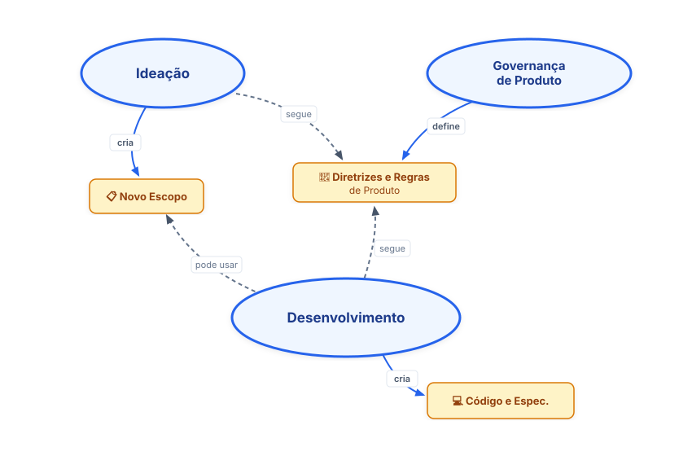
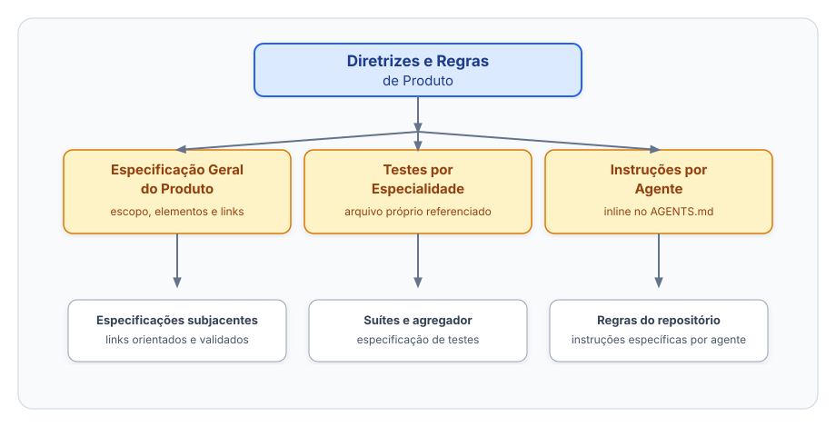
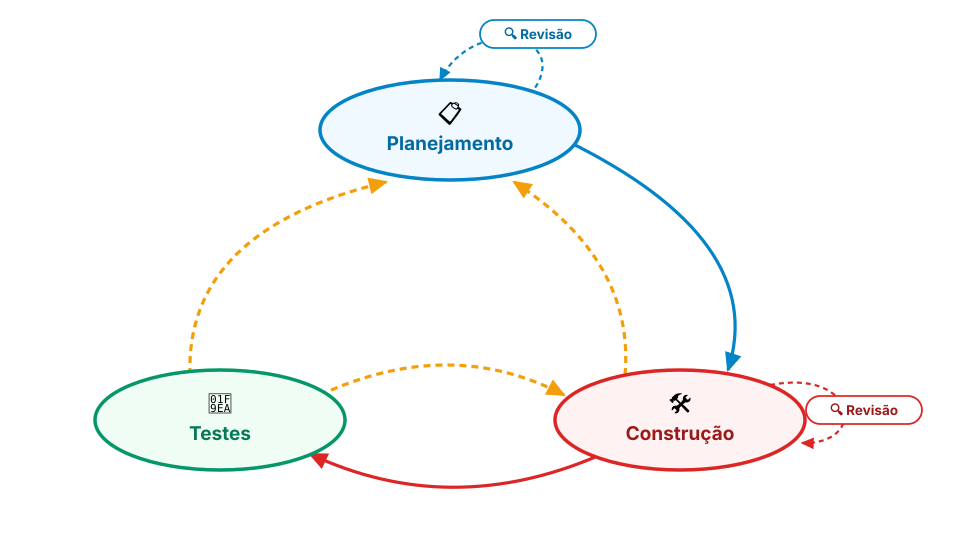
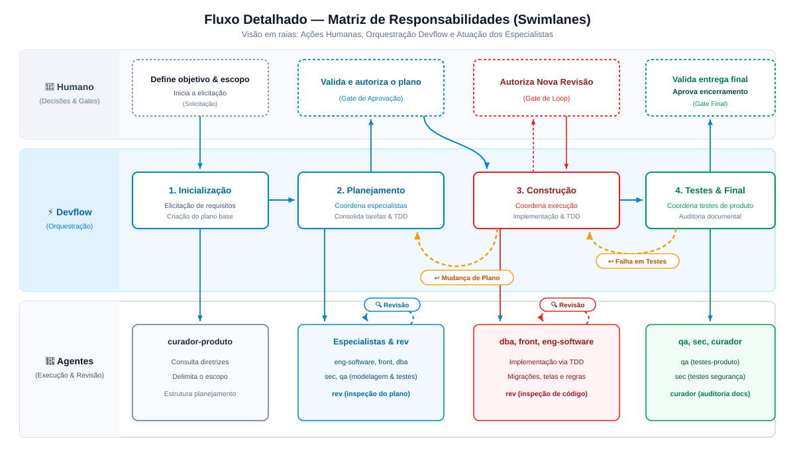

# Framework de Desenvolvimento Agêntico

## Objetivo

Criar uma organização em torno de especificações de negócio, testes e regras de validação que sirvam de memória do
produto, contexto e harness para que agentes consigam evoluir no desenvolvimento do produto de maneira controlada, com
insumo para que os humanos possam entender o sistema e orientar os agentes.

📍 **Navegar pelo diagrama:** [Governança de Produto](#governanca) · [Ideação](#ideacao)  · [Desenvolvimento](#desenvolvimento)

## Governança de Produto

A Governança de Produto é a dimensão responsável por estabelecer, organizar e manter a memória viva do sistema. Seu papel é definir a estrutura das especificações de negócio, os contratos técnicos, as suítes de validação e as instruções operacionais que servem de contexto e *harness* para todo o ciclo de vida do software.

O **`curador-produto`** é o único agente responsável por conduzir entrevistas estruturadas com o humano para criar ou modificar as Diretrizes e Regras de Produto, mas ele pode ser intermediado por outros agentes. Ele também revisa e valida se as diretrizes foram seguidas em um fluxo de desenvolvimento.

As Diretrizes e Regras de Produto orientam o trabalho dos agentes e documentam as decisões de especificação para o humano.

### Diretrizes e Regras de Produto

As Diretrizes e Regras de Produto reúnem os documentos que orientam a organização, a especificação e a validação do produto.

O `AGENTS.md` mantém a seção central de diretrizes. Ela aponta para a **Especificação do Produto**, referencia o arquivo de **Testes por Especialidade** e contém, inline, as **Instruções por Agente**.

O `curador-produto` é responsável por criar, atualizar e validar esse conjunto. Os demais agentes consultam a seção de diretrizes do `AGENTS.md` e seguem as referências encontradas nela, sem depender de caminhos fixos em seus próprios prompts.

As Diretrizes e Regras de Produto são formadas pelos documentos abaixo.
Cada repositório mantém os links para as versões vigentes de suas
especificações. Os templates usados pelo `curador-produto` estão
referenciados aqui:

- **Especificação do Produto:** descreve o escopo, os elementos de
  especificação, as regras de documentação e os links para os documentos
  que detalham cada parte do produto. Ele registra como o projeto guarda
  requisitos, critérios de aceitação, casos de uso, histórias e diagramas,
  preferencialmente como **Especificações Executáveis**.
  [Consultar template](../harness-conf/agents/default-artifacts/doc-readme-template.md)

- **Testes por Especialidade:** define as suítes de validação do produto,
  os testes de cada especialidade, os critérios de execução, os limites e
  o formato dos resultados. Define os testes necessários para considerar
  uma alteração concluída.
  [Consultar template](../harness-conf/agents/default-artifacts/testes-por-especialidade-template.md)

- **Seção de Diretrizes no `AGENTS.md`:** reúne o índice da Especificação
  do Produto, a referência ao arquivo de Testes por Especialidade e as
  Instruções por Agente. O template define como essa seção deve ficar no
  projeto-alvo.
  [Consultar template](../harness-conf/agents/default-artifacts/diretrizes-regras-produto-agents-md-template.md)

## Ideação

A Ideação transforma uma necessidade, hipótese ou história em um escopo
com requisitos e critérios de aceitação revisados antes do Desenvolvimento.
O fluxo é independente do Desenvolvimento e pode preparar uma história
para execução imediata ou para um ciclo futuro.

[Consultar o Fluxo de Definição de Escopo](./workflow-definicao-escopo.md)

## Desenvolvimento

- [Contratos do Fluxo](#contratos-do-fluxo)
- [Etapas/Fases](#etapasfases)
  - [Planejamento](#planejamento)
  - [Construção](#construcao)
  - [Revisão](#revisao)
  - [Testes](#testes)
- [Fluxo das Etapas/Fases](#fluxo-das-etapasfases)
  - [Agentes e responsabilidades](#agentes-e-responsabilidades)
  - [Premissas](#premissas)
  - [Fluxo Detalhado](#fluxo-detalhado)

### Contratos do Fluxo

O Fluxo se apoia em três contratos. Cada contrato tem
uma seção própria e deve permanecer verificável.

#### 1. Diretrizes e Regras de Produto

As [Diretrizes e Regras de Produto](#diretrizes-e-regras-de-produto)
são insumos para o Fluxo. Ao receber uma solicitação, antes da
confirmação definitiva do escopo, o `devflow` aciona o
`curador-produto` para verificar se elas estão adequadas ao ciclo.

Se estiverem adequadas, o Fluxo continua com o escopo original. Se
houver lacunas, o `devflow` pergunta ao humano se o escopo do ciclo
deve passar a ser a definição das Diretrizes e Regras de Produto.
Se o humano recusar, o escopo original permanece e a lacuna é
registrada no Arquivo de Planejamento. Se aceitar, o `devflow`
medeia a definição do trabalho com o `curador-produto`. O escopo
resultante segue as mesmas fases, gates e regras de acionamento dos
demais escopos.

#### 2. Novo escopo

Na entrada do Fluxo, o `devflow` verifica primeiro as Diretrizes e
Regras de Produto. Depois, confirma se o novo escopo está definido.
Se o humano quiser fazer uma elicitação especializada, pode
recomendar o `analista`, seguindo o fluxo da [Ideação](#ideacao).

Se o humano preferir continuar, o `devflow` ajuda a definir o
escopo por perguntas mediadas. O plano só nasce depois dessa
definição.

#### 3. Arquivo de Planejamento

Fonte de verdade temporária durante o Fluxo. Criado pelo
`devflow` depois da definição do escopo, é entrada e saída de
cada agente. É commitado durante o trabalho como ponto de
salvamento e consultado para retomada e auditoria. É excluído
no encerramento com autorização humana.

O planejamento é produzido pelos agentes e consolidado pelo
`devflow`. O `devflow` apresenta ao humano o recorte do
planejamento que requer decisão. O Arquivo de Planejamento é a
implementação operacional desse planejamento, usada pelos agentes
durante a execução. O humano não precisa ler o arquivo integralmente,
e os agentes não devem pressupor que ele acompanha seu conteúdo.

##### Formato do arquivo

O arquivo de planejamento segue o template definido pela skill
`planning-and-task-breakdown`.

Para permitir a retomada do Fluxo, mantém:

- `Status` no topo, indicando a fase atual;
- `## Perguntas`, para decisões pendentes do humano;
- `## Evidências de Testes — <fase>`, para evidências produzidas;
- o executor e o modelo utilizados nos registros de trabalho;
- o histórico das alterações relevantes.

O `devflow` atualiza o `Status` quando o agente que conclui
uma fase retorna. Na construção, o arquivo registra etapas concluídas.
Na revisão, registra os resumos dos agentes. Alterações no plano
ocorrem na Revisão do Plano ou no gate de refatoração.

O arquivo é o handoff entre instâncias. Os agentes consultam o
arquivo para recuperar o contexto do Fluxo, em vez de depender
do histórico da conversa.

##### Status válidos

O campo `Status` representa o ponto atual do Fluxo e pode assumir:

- `PLANEJAMENTO`;
- `REVISÃO DO PLANO`;
- `CONSTRUÇÃO`;
- `GATE-REFATORAÇÃO — volta ao planejamento`;
- `REVISÃO DA CONSTRUÇÃO`;
- `TESTES`;
- `FINALIZAÇÃO`.

`INICIALIZAÇÃO` não recebe um `Status` próprio. Ela é uma rotina de
entrada do `devflow`.

### Etapas/Fases

As etapas descrevem o tipo de trabalho realizado, seu resultado e
suas entradas e saídas. A ordem, os gates e os retornos
ficam no [Fluxo das Etapas/Fases](#fluxo-das-etapasfases).

#### Planejamento

Define o escopo técnico, organiza as decisões e produz o
planejamento necessário para a execução. O resultado é um
planejamento consolidado, com critérios e insumos para orientar
as etapas seguintes.

#### Construção

Realiza as alterações previstas no planejamento e integra os
resultados produzidos durante a execução. O resultado é uma
implementação coerente com o escopo e as decisões registradas.

#### Revisão

Revisa o planejamento e a implementação contra o escopo, as
decisões e os critérios definidos. Não é uma etapa independente.
O resultado é um conjunto de achados que orienta decisões de
correção.

#### Testes

Verifica o comportamento implementado e a cobertura prevista para
o ciclo. O resultado é um conjunto de evidências sobre a
implementação e os testes executados.

### Fluxo das Etapas/Fases

#### Agentes e responsabilidades

A tabela a seguir identifica os agentes, as fases em que participam no Fluxo de Desenvolvimento e a responsabilidade de cada um por
fase.

| Agente            | Planejamento             | Construção                | Revisão                        | Testes                 |
|-------------------|--------------------------|---------------------------|--------------------------------|------------------------|
| `devflow`         | Roteia e mantém status   | Roteia e mantém status    | Roteia a revisão               | Roteia e mantém status |
| `curador-produto` | Valida diretrizes        | —                          | Valida aderência às diretrizes| Valida evidências     |
| `eng-software`    | Planeja o código         | TDD e integração          | Corrige achados                | —                      |
| `front`           | Prototipa telas          | Implementa a UI           | Corrige achados visuais        | —                      |
| `dba`             | Modela dados             | Atualiza modelo e scripts | Corrige achados de dados       | —                      |
| `sec`             | Analisa requisitos       | Gera configurações        | Corrige achados de segurança   | Executa roteiro manual |
| `rev`             | —                        | —                         | Faz revisão independente       | —                      |
| `qa`              | Planeja testes           | —                         | —                              | Executa as suítes      |

A disposição dos agentes no processo de desenvolvimento foi otimizada para:

- **separação de contexto** por especialidade;
- **redução de consumo de tokens** via delegação focada;
- **qualidade** através de gates de revisão obrigatórios;
- **governança** com o humano no loop em pontos-chave;
- **higiene de contexto** — cada unidade de trabalho usa a instância
  adequada, com o arquivo de planejamento como handoff.

#### Premissas

1. **Commits e pontos de salvamento**
   - O `eng-software` é o **único committer** do Fluxo.
     Especialistas (`dba`, `sec`, `qa`, `front`, `rev`,
     `curador-produto`) apenas editam arquivos e
     reportam `[arquivos alterados + resumo]` ao solicitante, `eng-software` revisa o
     diff do especialista antes de commitar.
   - O `eng-software` carrega e segue a skill
     `git-workflow-and-versioning`: commits atômicos por unidade
     lógica, higiene pré-commit e mensagens Conventional Commit.
     Nunca inclui alterações alheias não reportadas. Nunca
     executa `git push` sem confirmação explícita do humano.

2. **Papel do `devflow`**
   - O `devflow` conhece o Fluxo e atua como roteador stateless.
   - **Nunca executa** tarefas de domínio.

3. **Contrato de retorno**
   - Todo agente persiste o resultado no Arquivo de Planejamento e retorna um resumo de handoff autocontido, proporcional à tarefa. O resumo informa apenas o resultado, os arquivos ou artefatos alterados, decisões ou impactos, bloqueios ou perguntas pendentes e as skills usadas. Deve ter até cinco itens curtos e exceder esse limite apenas quando a omissão impedir a retomada do trabalho. Detalhes ficam no arquivo de planejamento.
   - A última linha informa `Skills: skill1, skill2` ou `Skills: nenhuma`.

4. **Instâncias**
   - Uma instância representa uma unidade de trabalho coerente,
     formada pelo mesmo objetivo, critérios de aceitação, artefatos
     lógicos, papel do agente e premissas do plano.
   - A mudança de fase, sozinha, não obriga a criar uma instância nova.
     O `devflow` reutiliza a instância quando o trabalho continua no
     mesmo objetivo e o contexto permanece relevante e confiável.
   - Uma nova instância é criada quando há mudança de escopo,
     comportamento, arquitetura ou premissa, tarefa independente ou
     paralela, troca de modelo ou capacidade, ou perda de confiança no
     contexto.
   - Toda revisão usa uma instância nova e não reutiliza a instância do
     executor. Correções após revisão podem reutilizar o executor
     quando continuam na mesma unidade de trabalho.
   - Falhas transitórias podem ser reexecutadas na mesma instância.
     Falhas com estado parcial, contraditório ou contaminado exigem
     outra instância.
   - Quando houver dúvida entre reutilizar e criar, o `devflow` cria
     uma instância nova. A decisão considera o custo total da tarefa,
     incluindo contexto acumulado, latência e retrabalho, não apenas
     os tokens da próxima chamada.
   - Antes de trocar ou criar uma instância, o estado e o último
     handoff são persistidos no Arquivo de Planejamento. Instâncias
     novas recebem briefing autocontido. Instâncias reutilizadas
     recebem apenas as mudanças e os trechos necessários.
   - O Fluxo nunca retoma uma sessão arbitrária ou sem referência
     no Arquivo de Planejamento. Se o harness não permitir reutilizar a
     instância registrada, o `devflow` cria outra com o estado
     persistido.

5. **Mediação de perguntas**
   - Perguntas dos agentes passam pelo `devflow`.
   - A mediação usa a skill `question-orchestration`, o Checklist
     estrutural, a Continuidade da mediação e o Prompt-improver
     para handoff.
   - O `devflow` pode usar a skill `humanizer-br` para melhorar
     a clareza das perguntas, respostas e resumos destinados ao
     humano. A skill não decide requisitos nem altera decisões.

6. **Falhas**
   - Falhas de agentes são registradas e encaminhadas ao `devflow`.
   - O `devflow` tenta reexecutar ou encaminhar o trabalho a outro
     agente quando isso não altera premissas nem planejamento.

7. **Escalonamento ao humano**
   - O `devflow` consulta o humano apenas quando o problema pode
     alterar uma premissa, o escopo, o comportamento esperado,
     a arquitetura, o design de alto nível ou o planejamento
     apresentado.
   - Detalhes específicos de implementação, formatação dos
     arquivos de trabalho e registros usados apenas pelos agentes
     não são repassados ao humano quando puderem ser resolvidos
     dentro do planejamento existente.

8. **Agnosticismo dos agentes**
   - Os prompts dos agentes descrevem capacidades, nunca fases.
   - Apenas o `devflow` conhece o Fluxo. Essa regra torna os demais agnósticos: não o mencionam e não encaminham pergunta nem falha a ele. No Fluxo, o `devflow` sempre medeia. Fora do Fluxo, ou no uso parcial, o agente responde a quem o acionou e segue utilizável.

9. **Seleção de modelo**
   - Ao iniciar, o `devflow` sugere um modelo por etapa.
     O humano define se prefere um modelo único, modelos por
     fase ou outro arranjo. O mapa combinado fica registrado
     no arquivo.
   - Se o harness suportar seleção de modelo por chamada,
     o mapa é aplicado em cada spawn. Sem esse suporte, o
     Fluxo pausa antes de uma fase que exija outro modelo.

10. **Estado do Fluxo**
   - O estado vive no arquivo de planejamento e na memória de
     longo prazo.
   - O arquivo preserva o `Status`, as perguntas, as evidências,
     o histórico e os registros necessários para o handoff.

11. **Gestão de contexto**
   - Cada spawn recebe um briefing autocontido e apenas os trechos
     necessários do estado persistido.
   - O harness escolhe o mecanismo adequado para compactar,
     recuperar ou limitar o contexto em cada ambiente.
   - O Fluxo não depende de uma ferramenta específica de
     compactação. O agente lê trechos direcionados e não reinsere
     arquivos e logs completos no contexto.

#### Fluxo Detalhado

Em cada transição, o `devflow` lê o Arquivo de Planejamento,
identifica a fase pelo `Status`, aciona o agente adequado e recebe
um resumo curto. Os passos abaixo agrupam ações relacionadas, sem
alterar a ordem das chamadas, as decisões ou as transições de
`Status`. Se houver falha, re-spawna o agente ou consulta o humano
conforme as regras de falha.

1. **Inicialização**

   1.1. **Verificação inicial das Diretrizes e Regras de Produto**:
   Ao receber uma solicitação, o `devflow` primeiro aciona o
   `curador-produto` para verificar se a Especificação do Produto, os
   Testes por Especialidade e as Instruções por Agente estão adequados.
   Se houver um escopo apresentado, ele serve de contexto para a
   verificação. O `curador-produto` retorna o resultado e as lacunas
   encontradas.

   1.2. **Lacunas nas diretrizes**: Se houver lacuna, o `devflow`
   pergunta ao humano se deseja transformar o escopo do ciclo na
   definição das Diretrizes e Regras de Produto. Se o humano recusar,
   o escopo original permanece e a lacuna é registrada em
   `## Perguntas`. Se aceitar, o escopo passa a ser a definição das
   Diretrizes e Regras de Produto, e o `devflow` medeia com o
   `curador-produto` o detalhamento do trabalho, das decisões e das
   aprovações necessárias.

   1.3. **Entrada e definição do escopo**: Depois da verificação e da
   decisão sobre as lacunas, o humano apresenta ou confirma o escopo.
   Se o escopo não estiver definido, o `devflow` informa que o
   `analista` pode ser mais adequado para conduzir a elicitação e
   pergunta ao humano se deseja utilizar esse Fluxo. Se o humano
   utilizar o `analista`, o `devflow` aguarda o retorno com o escopo
   definido na conversa ou em um artefato. Se preferir continuar com
   o `devflow`, ele conduz perguntas mediadas até o escopo estar
   definido. Se o escopo já estiver definido, o `devflow` confirma o
   entendimento com o humano.

   1.4. **Criação do Arquivo de Planejamento**: Depois que o escopo e
   a decisão sobre as diretrizes estiverem definidos, o `devflow`
   cria o Arquivo de Planejamento e registra o escopo, sua origem
   quando aplicável, o resultado da verificação e as decisões
   iniciais. O arquivo recebe `Status: PLANEJAMENTO`. O Fluxo não
   cria o arquivo antes da definição do escopo.

2. **Planejamento**

   2.1. **Consultas especializadas**: O `devflow` aciona os agentes
   responsáveis pelos itens do escopo e do plano, na seguinte ordem:

   1. `eng-software` para planejar a implementação;
   2. `front`, se houver interface de usuário, para prototipar as telas;
   3. `dba` para modelar os dados e registrar alterações de modelo, schema ou migrações;
   4. `sec` para analisar os requisitos de segurança e registrar ameaças e controles;
   5. `qa` para planejar os testes previstos no ciclo, conforme o plano e a especificação de
      Testes por Especialidade.

   Cada agente registra o resultado no Arquivo de Planejamento e retorna um resumo curto.

   2.2. **Dúvidas e decisões**: Agentes com dúvidas salvam o progresso parcial e retornam ao
   `devflow` para mediação. Decisões não triviais são mediadas com o humano. Arquivos grandes
   podem exigir divisão de escopo e desvios de identidade visual exigem nova aprovação.

   2.3. **Transição para a revisão do plano**: Depois de consolidar os retornos, o `devflow`
   atualiza o arquivo para `Status: REVISÃO DO PLANO`.

3. **Revisão do plano**

   3.1. **Revisão e achados**: O `devflow` aciona uma nova instância do `rev`. O `rev` revisa o
   plano com as skills de domínio aplicáveis, usando o plano e os insumos originais do humano,
   e retorna os achados no formato `achado · ação · severidade`. O `devflow` registra o
   resultado e encaminha cada achado ao especialista responsável.

   3.2. **Correções e re-revisão**: Quando os achados exigirem correção, o `devflow` aciona o
   especialista responsável. Depois da correção, o `devflow` apresenta ao humano o resultado e
   pergunta se deve acionar uma nova instância do `rev`. Somente uma resposta afirmativa permite
   nova revisão. Se o humano recusar, o Fluxo segue para a apresentação e aprovação do plano. O
   humano controla as re-revisões e impede loops infinitos.

   3.3. **Aprovação e transição**: O `devflow` consolida o planejamento e apresenta ao humano o
   recorte que requer decisão. O humano decide sobre o planejamento apresentado, não sobre o
   arquivo operacional. Depois da aprovação, o `devflow` atualiza o arquivo para
   `Status: CONSTRUÇÃO`.

4. **Construção**

   4.1. **Execução da construção**: O `devflow` aciona, na sequência
   técnica prevista no plano, os agentes responsáveis pelos itens da
   construção. Cada agente produz os artefatos atribuídos ao seu
   escopo, quando previstos no plano:

   1. `dba` para produzir ou atualizar o modelo de dados, as migrações e os demais artefatos de
      banco previstos no plano;
   2. `front`, se houver interface, para implementar as telas conforme o protótipo aprovado;
   3. `eng-software` para conduzir TDD, integrar os artefatos, normalizar o lote e criar o
      commit conforme a skill `git-workflow-and-versioning`.

   4.2. **Gate e transição**: Se a execução atingir o gate de refatoração ou exigir mudança
   significativa no plano, o `eng-software` informa o `devflow`, que apresenta ao humano o
   impacto da integração. O humano decide entre:

   1. manter o planejamento e ajustar apenas a implementação;
   2. aprovar um ajuste mínimo e registrá-lo no Arquivo de Planejamento;
   3. retornar ao Planejamento para revisar as premissas, o comportamento ou a arquitetura.

   O `devflow` não escolhe sozinho entre essas opções. A Construção só prossegue depois da
   decisão humana. Quando a construção for concluída, o `devflow` atualiza o arquivo para
   `Status: REVISÃO DA CONSTRUÇÃO`.

5. **Revisão da construção**

   5.1. **Revisão e achados**: O `devflow` aciona uma nova instância do `rev` para verificar a
   implementação contra o plano, as especificações e os artefatos produzidos. O `rev` não
   corrige a implementação, retorna os achados no formato `achado · ação · severidade`, e o
   `devflow` os encaminha aos especialistas responsáveis.

   5.2. **Correção e re-revisão**: O especialista responsável corrige os achados. Depois, o
   `devflow` apresenta ao humano o resultado e pergunta se deve acionar uma nova instância do
   `rev`. Somente uma resposta afirmativa permite nova revisão. Se o humano recusar, o Fluxo segue
   para Testes. O humano controla as re-revisões e impede loops infinitos.

   5.3. **Transição para Testes**: Quando a revisão da construção terminar, o `devflow` atualiza
   o arquivo para `Status: TESTES`.

6. **Testes**

   6.1. **Execução e evidência**: O `devflow` aciona o `qa` para executar `testes-produto` e os
   testes previstos no plano, conforme a especificação de Testes por Especialidade. O `qa` não
   analisa código e registra no Arquivo de Planejamento a evidência do agregador no formato JSON
   `{ status, findings[] }`.

   6.2. **Segurança e validação da evidência**: Depois da execução, o `devflow` aciona o `sec`
   para executar o roteiro manual de segurança e registrar o resultado. Em seguida, aciona o
   `curador-produto` para validar a evidência do agregador contra a especificação de Testes por
   Especialidade.

   6.3. **Falhas e retorno**: Se houver falha, o `devflow` encaminha a correção conforme a
   especialidade:

   - backend: `eng-software`;
   - dados: `dba`;
   - segurança automática: `sec`;
   - frontend: `front`.

   Depois da correção, o `devflow` aciona o `eng-software` para normalizar o lote e criar o
   commit. Em seguida, reexecuta obrigatoriamente os testes automáticos determinísticos. Uma
   falha não pode ser aceita ou contornada: a fase só avança quando os testes passam. Se a mesma
   falha persistir por três execuções consecutivas, o `devflow` pergunta ao humano se deve
   interromper novas tentativas para realizar uma análise diagnóstica adicional. Essa análise
   não autoriza seguir sem aprovação dos testes. Se a falha exigir mudança de escopo ou
   comportamento, o `devflow` retorna ao Planejamento. Caso contrário, retorna à Construção.

   6.4. **Transição para Finalização**: Quando os testes e a validação das evidências terminarem,
   o `devflow` atualiza o arquivo para `Status: FINALIZAÇÃO`.

7. **Finalização**

   7.1. **Revisão final e lacunas**: O `devflow` aciona o `curador-produto` para revisar as
   especificações e verificar se os artefatos obrigatórios estão presentes. O `curador-produto`
   retorna as lacunas encontradas. Se houver lacunas, o `devflow` aciona o `eng-software` para
   criar ou atualizar os artefatos de especificação necessários.

   7.2. **Revalidação**: Depois de cada correção, antes de iniciar uma nova
   revalidação, o `devflow` pergunta ao humano se deseja continuar. Se a
   resposta for afirmativa, aciona o `curador-produto` para revalidar as
   especificações. Se a resposta for negativa, interrompe o Fluxo, registra
   as lacunas restantes e preserva o Arquivo de Planejamento e os artefatos
   auxiliares. Se a revalidação encontrar novas lacunas, o mesmo gate deve
   ser aplicado antes de outro ciclo de correção e revalidação.

   7.3. **Conclusão e exclusão do planejamento**: Quando os gates forem concluídos, o `devflow`
   informa ao humano que o Fluxo foi concluído e solicita autorização para excluir o Arquivo de
   Planejamento e os artefatos auxiliares. Após a autorização, o `curador-produto` exclui o
   Arquivo de Planejamento e os artefatos auxiliares.
