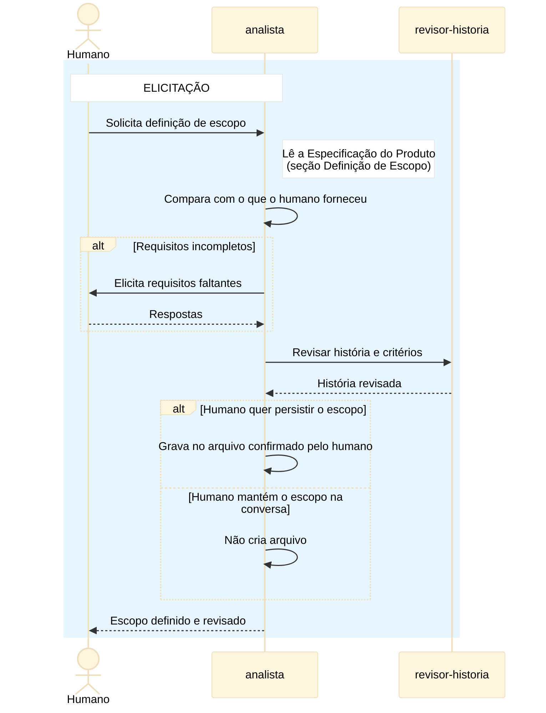

# Workflow de Definição de Escopo

## Objetivo

Workflow independente de elicitação. O `analista` conversa
diretamente com o humano para definir histórias, requisitos e
critérios de aceitação.

O resultado pode permanecer na conversa ou ser gravado no
destino indicado nas Diretrizes e Regras de Produto, seguindo a
referência para a seção Definição de Escopo da Especificação do
Produto. Se a seção não indicar o destino, o `analista` combina
com o humano onde gravar o resultado.

**Premissa:** a documentação do produto em
`AGENTS.md`, a Especificação do Produto, os Testes por Especialidade
e as Instruções por Agente já estão presentes e válidos antes deste
workflow para consulta durante a elicitação.

## Agentes

| Sigla | Nome completo | Tipo | Fases onde atua |
|-------|--------------|------|----------------|
| `analista` | Analista de Backlog | Executor | Elicitação |
| `revisor-historia` | Revisor de Histórias | Executor | Elicitação |

## Premissas

1. **Documentação do produto já está disponível** —
   as Diretrizes e Regras de Produto existem e estão válidas.
   Este workflow assume isso como pré-condição.
2. **`analista` nunca edita a Especificação do Produto** — apenas
   lê a Especificação do Produto referenciada nas Diretrizes e
   Regras de Produto e consulta a seção Definição de Escopo para
   contextualizar a elicitação.
3. **Destino do escopo** — a seção Definição de Escopo da
   Especificação do Produto indica onde gravar a história. Se a
   seção não indicar o destino, o `analista` combina com o humano
   onde consultar histórias existentes e onde gravar o resultado.
   Se o humano preferir manter o resultado na conversa, nenhum
   arquivo é criado.

## Fluxo

### Elicitação

O humano inicia o `analista` diretamente. O analista conduz a
elicitação diretamente com o humano:

1. Analista carrega `question-orchestration` no modo direto e
   consulta as Diretrizes e Regras de Produto, seguindo a referência
   para a seção Definição de Escopo da Especificação do Produto, além
   de ler o que o humano forneceu
2. Compara: bate com o definido na seção Definição de Escopo?
3. Se faltar → elicita com humano
4. Define se o resultado fica na conversa ou em um arquivo
   indicado pelo humano
5. Usa `revisor-historia` para revisar
6. Quando OK → apresenta ao humano o escopo revisado para
   confirmação ou novos ajustes

## Fluxo — Diagrama de Sequência

## Regras Críticas

- `analista` **nunca** edita a Especificação do Produto
- A Especificação do Produto contém a seção Definição de Escopo
  **antes** da atuação do `analista`
