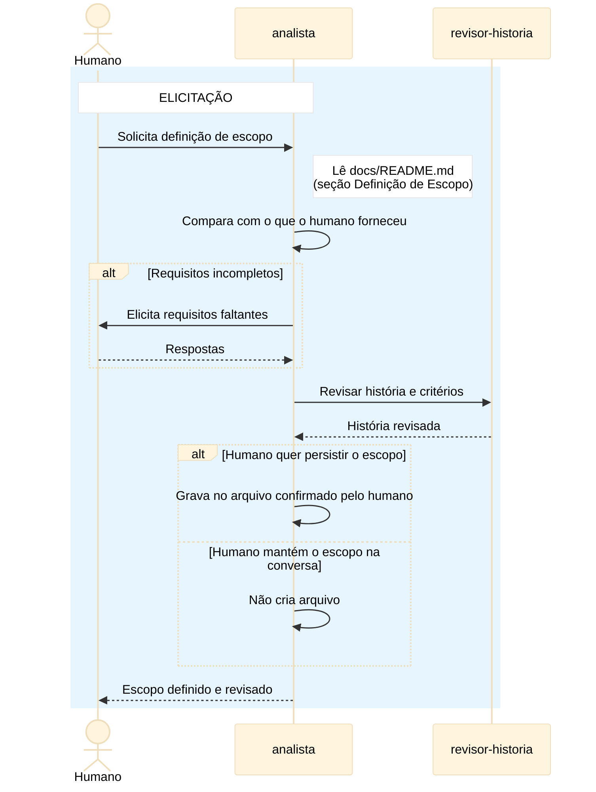

# Workflow de Definição de Escopo

## Objetivo

Workflow independente de elicitação. O `analista` conversa
diretamente com o humano para definir histórias, requisitos e
critérios de aceitação.

O resultado pode permanecer na conversa ou ser gravado no
destino indicado na seção Definição de Escopo do Mapa do Produto.
Se a seção não indicar o destino, o `analista` combina com o
humano onde gravar o resultado.

**Premissa:** a curadoria já foi executada antes deste
workflow. `docs/README.md` e Testes por Especialidade estão
presentes e válidos para consulta durante a elicitação.

## Agentes

| Sigla | Nome completo | Tipo | Fases onde atua |
|-------|--------------|------|----------------|
| `analista` | Analista de Backlog | Executor | Elicitação |
| `revisor-historia` | Revisor de Histórias | Executor | Elicitação |

## Premissas

1. **Curadoria já foi concluída** — docs/README.md e
   Testes por Especialidade existem e estão válidos. Este
   workflow assume isso como pré-condição.
2. **`analista` nunca edita `docs/README.md`** — apenas
   lê a seção Definição de Escopo para contextualizar
   a elicitação.
3. **Destino do escopo** — a seção Definição de Escopo do Mapa
   do Produto indica onde gravar a história. Se a seção não
   indicar o destino, o `analista` combina com o humano onde
   consultar histórias existentes e onde gravar o resultado.
   Se o humano preferir manter o resultado na conversa, nenhum
   arquivo é criado.

## Fluxo

### Elicitação

O humano inicia o `analista` diretamente. O analista conduz a
elicitação sem um orquestrador intermediário:

1. Analista carrega `question-orchestration` no modo direto
   e lê a seção Definição de Escopo do Mapa do Produto + o
   que o humano forneceu
2. Compara: bate com o definido na seção?
3. Se faltar → elicita com humano
4. Define se o resultado fica na conversa ou em um arquivo
   indicado pelo humano
5. Usa `revisor-historia` para revisar
6. Quando OK → apresenta ao humano o escopo revisado para
   confirmação ou novos ajustes

## Fluxo — Diagrama de Sequência

## Regras Críticas

- `analista` **nunca** edita `docs/README.md`
- `curador-produto` cria a seção Definição de Escopo no
  `docs/README.md` **antes** do analista atuar
