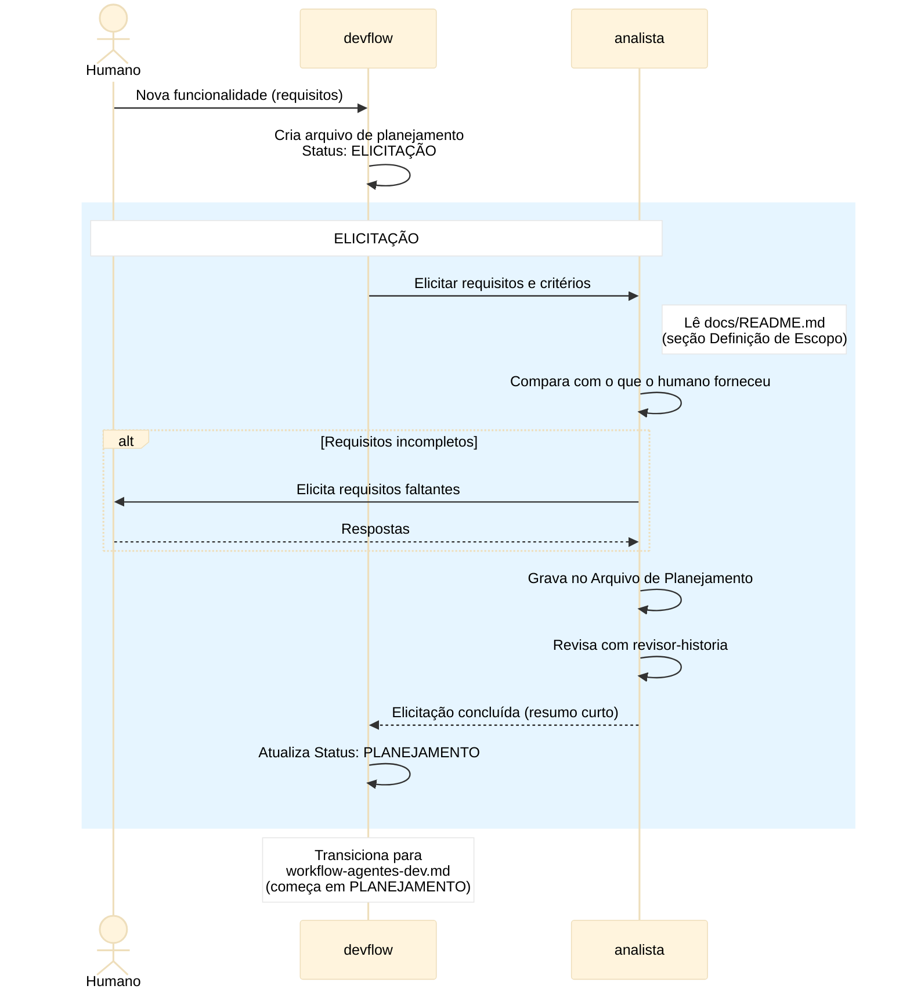

# Workflow de Definição de Escopo

## Objetivo

Workflow de elicitação que produz o Arquivo de
Planejamento com requisitos e critérios definidos pelo
humano.

**Premissa:** a documentação do produto em
`docs/README.md` já está presente e válida antes deste
workflow.

O `devflow` executa este workflow e, ao final,
transiciona para o workflow de desenvolvimento (que
começa em PLANEJAMENTO).

## Agentes

| Sigla | Nome completo | Tipo | Fases onde atua |
|-------|--------------|------|----------------|
| `devflow` | Orquestrador | Roteador stateless | todas (roteia) |
| `analista` | Analista de Backlog | Executor | Elicitação |
| `revisor-historia` | Revisor de Histórias | Executor | Elicitação |

## Premissas

1. **`devflow` como roteador stateless** — spawna agentes,
   não lê, não valida. Recebe resumo curto de volta.
2. **Documentação do produto já está disponível** —
   `docs/README.md` existe e está válido. Este workflow
   assume essa pré-condição.
3. **`analista` nunca edita `docs/README.md`** — apenas
   lê a seção Definição de Escopo para contextualizar
   a elicitação.
4. **Arquivo de Planejamento é criado aqui** — o `devflow`
   cria o arquivo no início deste workflow.
5. **Transição para dev** — quando o analista conclui
   a elicitação, `devflow` transiciona para o workflow de
   desenvolvimento, que começa em PLANEJAMENTO.

## Fluxo

### Elicitação

`devflow` instrui o HUMANO a trocar para o `analista`
(agente não mediado); o analista conduz a elicitação
direto com o humano:

1. Analista carrega `question-orchestration` no modo direto
   e lê `docs/README.md` (seção Definição de Escopo) + o
   que o humano forneceu
2. Compara: bate com o definido na seção?
3. Se faltar → elicita com humano
4. Grava no Arquivo de Planejamento
5. Usa `revisor-historia` para revisar
6. Quando OK → o HUMANO retorna ao `devflow`, que segue
   pela Transição

### Transição

`devflow` atualiza o `Status` do Arquivo de Planejamento
para `PLANEJAMENTO` e inicia o workflow de
desenvolvimento (`docs/workflow-agentes-dev.md`).

## Fluxo — Diagrama de Sequência

## Regras Críticas

- `analista` **nunca** edita `docs/README.md`
- `docs/README.md` contém a seção Definição de Escopo
  **antes** da atuação do `analista`
- `devflow` é roteador stateless — só spawna, não lê,
  não valida
